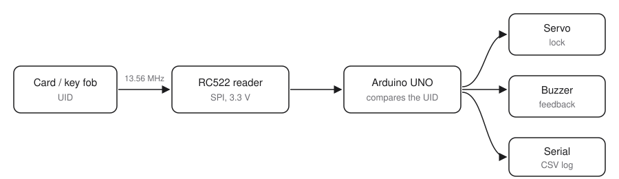

<h1 align="center">TapLock</h1>

<p align="center">
  An RFID lock built with an Arduino UNO.<br>
  A registered card opens a servo lock, an unknown card is refused, and every attempt is saved to a CSV file.
</p>

<p align="center">
  <a href="https://f1f2f0e0e4e0ede8ff0e.github.io/taplock/"><b>Project report</b></a>&nbsp;&nbsp;&nbsp;&nbsp;
  <a href="https://wokwi.com/projects/476354243482426369"><b>Wokwi simulation</b></a>
</p>

<p align="center">
  <picture>
    <source media="(prefers-color-scheme: dark)" srcset="assets/overview-dark.svg">
    
  </picture>
</p>

## How it works

The RC522 reader reads the UID of a contactless card and the Arduino looks it up in a list of authorised cards.

| Card | What happens | Logged as |
|---|---|---|
| In the list | short high beep, the servo opens for 5 s and closes by itself | `GRANTED` |
| Not in the list | long low beep, the servo stays closed | `DENIED` |
| Third wrong card in a row | all cards are ignored for 30 s | `LOCKOUT` |

The sketch is a `millis()` based state machine with three states and no `delay()`, so the reader keeps
working while the lock is open. Every value in the table is a constant at the top of
[`taplock.ino`](firmware/taplock/taplock.ino).

## Hardware

Arduino UNO R3, RC522 RFID reader with cards and key fobs, 9g micro servo, passive buzzer module.

| Module pin | UNO pin | Note |
|---|---|---|
| RC522 VCC | `3.3V` | never 5V, it can destroy the module |
| RC522 GND | `GND` | |
| RC522 RST | `D9` | |
| RC522 SDA | `D10` | SPI chip select |
| RC522 MOSI, MISO, SCK | `D11`, `D12`, `D13` | hardware SPI |
| Servo signal | `D6` | servo + to 5V, servo - to GND |
| Buzzer S | `D8` | buzzer + to 5V, buzzer - to GND |

## Getting started

### Simulation

The circuit runs in the browser on [Wokwi](https://wokwi.com/projects/476354243482426369). The same files are in
[`firmware/taplock/`](firmware/taplock). The green card and the key fob of the simulator are in the list,
the other preset cards are not.

### Real board

1. Install the **MFRC522** library by Miguel Balboa from the Library Manager of the Arduino IDE.
2. Upload [`read_uid.ino`](firmware/read_uid/read_uid.ino), open the serial monitor at 9600 baud and touch a card.
   It prints the UID as a line of code.
3. Paste that line into `AUTHORISED` in [`taplock.ino`](firmware/taplock/taplock.ino) and upload it.

### Logging

```bash
python3 -m pip install -r tools/requirements.txt
python3 tools/logger.py                          # lists the serial ports
python3 tools/logger.py /dev/cu.usbmodem14101    # writes every attempt to data/attempts.csv
```

The report page reads `data/attempts.csv` and shows a summary of the attempts.

## Repository

| Path | Contents |
|---|---|
| [`index.html`](index.html) | project report, published with GitHub Pages |
| [`PROPOSAL.md`](PROPOSAL.md) | project proposal |
| [`firmware/taplock/`](firmware/taplock) | main sketch, Wokwi diagram and library list |
| [`firmware/read_uid/`](firmware/read_uid) | helper sketch that prints card UIDs |
| [`tools/logger.py`](tools/logger.py) | serial logger |
| [`data/`](data) | attempt log and reader measurements |
